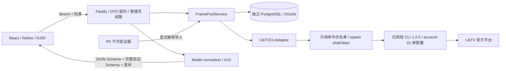

# P1-A 架构

本期为 L2：新增独立数据库、鉴权和服务边界。基于用户提供的《FramePool_LibTV_P1_OpenSource_PRD.md》v1.1，仅实施第 9 节 P1-A；不将 PRD 中后续阶段视为本轮执行授权。

## 职责

- `apps/admin-web/src/pages/`：总览、模型、连接、画布、日志。Refine 管理真实 API 数据与缓存，RJSF 渲染表单；页面不读取 P0 文件，不内置模型/节点数据。
- `apps/api-server/src/app.ts`：认证、管理员边界、严格请求校验、核心响应 DTO 校验、统一错误；不解析 CLI 字段。前端不存在任意命令执行接口。
- `apps/api-server/src/service.ts`：数据库业务流程、显式证据导入、模型版本/下架策略、账号本地管理、只读画布快照及审计。
- `packages/contracts`：请求/响应 Zod 合约、错误和阶段硬开关。
- `packages/model-normalizer`：LibTV tool_spec -> 标准字段树与完整验证 Schema、originalField 映射、差异路径、稳定 SHA256。只输出经过确认的字段，拒绝未知参数。
- `packages/libtv-cli-adapter`：命令级 JSON/NDJSON 适配、只读进程白名单、环境白名单、输出上限与脱敏；生成方法直接拒绝。
- `packages/db`：独立 PostgreSQL 表结构、Drizzle 迁移和连接；不访问境彻数据库。
- `tools/p1`：初始化、导入、实测、保护检查与依赖报告；不改写 `tools/libtv-p0`。

## 数据与读写边界

本期只有 5 张业务表：provider_connections、provider_models、projects、canvas_nodes、audit_events。Drizzle 自身迁移日志存于独立数据库的 drizzle schema。任务、尝试、资产、租约等 P1-B 表没有预填假记录，也未实现 Mock Worker。

模型以 `(provider, model_key)` 唯一；保留目录名称、Schema 名称、完整原文、哈希、版本、前一版本、变更路径。导入重复执行不增加 Schema 版本，不覆盖手动禁用/连接开关/别名，也不将已在线更新的 Schema 回退到旧证据。

在线同步先读取完整批次，全部成功才提交数据库事务。缺失模型改为 unverified；人工 disabled 保留。重新解除禁用后仍为 unverified，必须通过同步确认收录。listed 始终只表示目录已收录，不表示生成权限。

账号仅允许已授权 account-01；别名和启停只写本项目数据库。诊断调用官方 `account info`；不切换团队、不登录/登出、不复制凭据。项目列表固定个人根空间，保持 P0 的空间范围。刷新节点只查询远端，事务内替换本地快照，不执行任何上游编辑。

## 参数转换边界

枚举（含 displayName/value）、switch、数值 min/max/step、prompt 长度、模式相关 settings/advancedSettings、节点引用数量与可确认的必填规则可校验。字段树与完整验证 Schema 分离，避免 RJSF 将顶层 anyOf 渲染为重复表单；客户端 customValidate 和服务端 AJV 共用完整验证 Schema。

未经确认的能力、媒体元信息、activeWhen/pixelBudget 等只保留原文与转换提示，不允许作为未知可写参数通过。涉及媒体类型/whenHas 等无法确认的必填条件时，该模式 `canValidate=false`，前端关闭校验按钮，后端返回 SCHEMA_VALIDATION_UNSUPPORTED。当前 209 个推导模式中有 13 个受此限制，见 `docs/p1/safety-summary.json`。

参数校验成功只表示本期已覆盖的参数结构通过；`upstreamValidated=false`，不验证平台配额、素材本体或真实生成权限。

## 防生成与后续扩展

P1-A 编译期 `GENERATION_ENABLED=false`；环境配置为 true 时拒绝启动。UI 按真实 API 状态禁用生成；任务 POST 固定拒绝；Adapter.runNode 直接拒绝；进程边界仅允许审核过的只读参数数组。没有 create/upload/run 的生产接口。

当前审计计数是本服务记录的命令；不覆盖用户在其他终端手动执行的进程。账号目录同属当前 Windows 用户，不能代替系统用户/容器隔离。未来 P1-B 加入任务表、事务幂等、租约、needs_reconciliation 和队列时，仍不能以 BullMQ 重投递推导上游 exactly-once。
